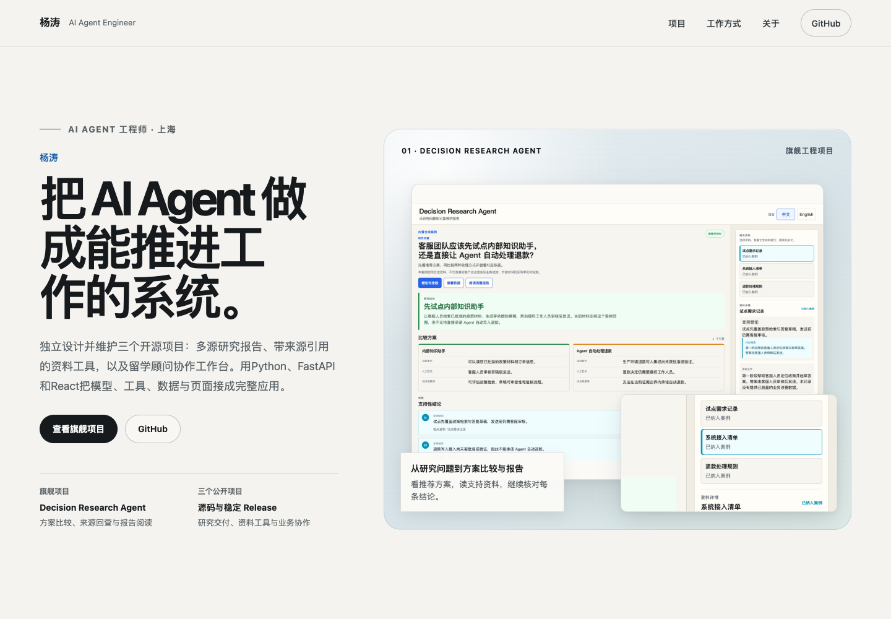

# Yang Tao · AI Agent Engineer

杨涛的个人工程作品集。网站以真实项目界面和自然中文说明，展示三个可以继续核验的 AI Agent 项目：

1. **Decision Research Agent**：组织多轮研究、方案比较与报告阅读，从结论回查支持资料；
2. **Night Voyager**：将预算变化、方案修订、顾问复核和客户确认放进同一客户案例的协作流程；
3. **Multimodal Knowledge Engine**：提供本地资料的检索、精确读取与来源引用，以及导出快照的离线查看器。



在线访问：[itao-ai.github.io/my-website](https://itao-ai.github.io/my-website/)

## 页面结构

- 候选人定位与 DRA 真实产品舞台；
- DRA 旗舰案例：客服试点方案比较、报告与来源阅读、待确认事项；
- Night Voyager / MKE 两个互补案例；
- Evidence、研究推进与人工确认三层能力关系；
- AI-native 工作方式、个人背景和公开联系入口；
- 三个项目各自的完整案例页、源码、稳定 Release 与固定提交的当前流程指南。

## 版本与当前公开源码

公开内容核对日期：**2026-11-08**。稳定 Release 和后续已公开源码分别展示；详情页的“公开源码的新流程”
不表示该流程已包含在对应 Release，也不表示已部署服务。

| 项目 | 稳定 Release | Release 之后的公开源码入口 |
| --- | --- | --- |
| Decision Research Agent | [v0.1.9](https://github.com/iTao-AI/decision-research-agent/releases/tag/v0.1.9) | [客服试点选型、报告与来源阅读](https://github.com/iTao-AI/decision-research-agent/blob/f40cde0be00bf55cf32c4eadbd2e62123f9e4035/README_CN.md) |
| Night Voyager | [v0.1.6](https://github.com/iTao-AI/night-voyager/releases/tag/v0.1.6) | [预算变更、重新确认与恢复](https://github.com/iTao-AI/night-voyager/blob/d11d31808e5a5c7d16d55350d6e6e4cd98c89422/docs/operations/customer-revision-recovery.md) |
| Multimodal Knowledge Engine | [v0.1.7](https://github.com/iTao-AI/multimodal-knowledge-engine/releases/tag/v0.1.7) | [离线阅读、完整存储文本与引用核对](https://github.com/iTao-AI/multimodal-knowledge-engine/blob/a7112a41727f27d6908191c63d5e1fe6f86f0510/docs/how-to/view-compiled-library.md) |

项目事实集中维护于 [`src/data/projects.ts`](src/data/projects.ts)。指南链接绑定本次核对的公开提交；
GitHub 入口继续指向各项目的最新源码。图片绑定包含其原始字节的公开提交，稳定 Release 保持原版本。

## 真实展示资产

页面中的项目界面直接复用三个公开仓库的已提交图片，没有重新生成或改写项目 UI。
网站使用 [`public/images/project-showcase-manifest.json`](public/images/project-showcase-manifest.json)
记录源项目、源提交、源路径、SHA-256、尺寸、页面用途和公开披露，并由内容验证脚本逐项核对。

DRA展示内置合成客服案例；Night Voyager展示本地合成咨询场景与独立受阻执行场景。
MKE首图是用仓库测试资料生成的离线查看器，另两图是发布／检索／恢复的独立技术演示帧；
三张图不表示同一界面的连续操作。查看器读取导出快照中的已提取文本，不回读原始PDF或媒体文件。

这些图片说明现有产品流程和工程机制，不代表真实客户、生产部署或业务收益。MKE查看器原图为
2880×1800，其余图片为1600×1000，均保持原始字节和8:5比例。

## 技术栈

- React 19
- TypeScript 6
- Vite 8
- CSS / Tailwind CSS 4
- GitHub Pages

站点保持固定浅色画布，不依赖境外字体 CDN，不新增运行时 UI 依赖。页面路由使用 URL hash；canonical
路径为 `#/projects/<slug>`，旧 `#project/<slug>` 链接会继续归一化，GitHub Pages base 为
`/my-website/`。

## 本地运行与验证

```bash
npm ci
npm run dev
```

完整静态检查：

```bash
npm run verify:public
npm run lint
npm run build
```

`npm run verify:public` 会检查项目顺序、公开文案、GitHub / Release 链接、hash route、九张展示图片的
provenance 与 SHA-256、PNG 尺寸、旧身份残留和敏感信息模式。

### 2026-11-08 本地验证

已在现有依赖环境运行内容验证、lint和构建。浏览器覆盖1440×1000与390×844下的首页和三项目详情，
共8组页面检查；18次项目图片状态切换、2次MKE原图打开及旧hash路由归一化通过。
原先的移动端固定宽度／位移会裁切新截图，现改为完整主图，并支持打开原图查看细节。
图片链接的键盘焦点框绘制在图片内部，避免被裁切容器遮住。
补充检查覆盖两种宽度下的6处图片焦点状态，以及2次Enter打开原图。
四张站点展示截图已随当前内容刷新。以上属于本地验证，不代表公开站点已发布。

## 内容边界

- 个人经历和项目能力只使用已确认事实与公开项目证据；
- 图片与当前流程绑定固定公开提交；历史 Release 单独保留，不把新流程写入旧版本；
- 三个项目是互补的独立实践，不表述为已经生产集成的平台；
- 不提交 secret、token、cookie、私有路径、真实客户资料或未验证指标。
